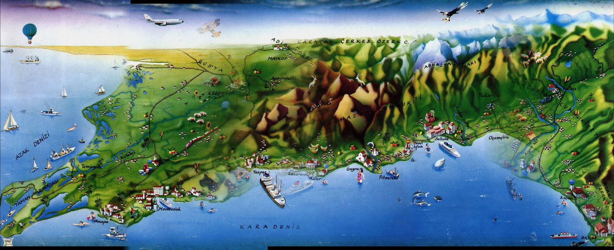

# Atlas Dergisi Arşivi → PDF

**1993-2005 Atlas dergisi DVD'lerindeki Flash dosyalarını, doğru sayfa sırasıyla tek komutla PDF'e çevirir.**



Atlas'ın 2000'lerin başında verdiği DVD'lerde her sayı `sayi4.bts`, `sayi5.bts` … gibi dosyalarla geliyordu. Bunlar aslında birer **Flash (SWF)** dosyası: derginin tüm sayfaları JPEG olarak içine gömülü. Flash Player 2020'de öldüğü için bu arşiv bugün açılmıyor — ama içindeki sayfalar sapasağlam duruyor.

Bu araç o sayfaları **derginin kendi sırasıyla** çıkarır, siyah dolguları yerleştirir, interaktif haritayı poster olarak birleştirir ve hepsini tek PDF yapar.

Arşivin tamamı **237 sayı** (1993-04 → 2012-12) ve iki ayrı hat ile üretilir:

| Dönem | Sayı | Kaynak | Script |
|-------|------|--------|--------|
| 1993-2005 | 153 | `.bts` = Flash (SWF), sayfalar gömülü | `atlas2pdf.py` |
| 2006-2012 | 84 | ayrı JPG klasörleri + Director `.dir` indeksi | `dvd2-images2pdf.py` |

Hangi bilginin **kesin**, hangisinin **çıkarım** olduğu aşağıdaki *Kesinlik tablosu* bölümünde yazılı — devam ederken önce oraya bakın.

---

## Neden "doğru sayfa sırası" bu kadar zor?

Denediyseniz bilirsiniz: `swfextract` ile görselleri çıkarırsınız, elinizde 200 küsur JPEG olur — ama sıra yanlıştır. Dergi sayfa 1 → 18 → 29 → 40 diye atlar. Elle sıralamak saatler sürer.

Sebep şu: bu dergilerde sayfalar Flash sahnesine (timeline) hiç konmaz, ActionScript ile çalışma anında çağrılır. Yani ne timeline sırası ne de görsel ID sırası işe yarar.

Gerçek sıra, SWF'in **`EXPORTASSETS`** etiketlerinde saklı: her sayfa sembolünün adı `p1`, `p2`, … `p107`. Ve işte tuzak:

```
Dosyada adlar alfabetik durur:   p1  p10  p100  p101  ...  p107  p11  p12  ...
Doğru sıra ise sayısal:          p1  p2   p3    p4    ...  p10   p11  p12  ...
```

Adlara göre sıralayan her araç (ve `swfextract`'ın çıktısı) sayfa sırasını mahveder. Bu proje adlardaki **sayıya** göre sıralar ve her sayfayı şu zincirle çözer:

```
"pN" export adı  →  sprite id  →  sprite'in PlaceObject2 çocuğu
                 →  DefineShape  →  bitmap fill id  →  JPEG
```

Ayrıca her sayı iki çözünürlükte gömülüdür (`pN` = 800×1067, `pageN` = 495×660). Sayfa kümesini **en çok etiketli aile** belirler (derginin tamamı), ama görsel **her sayfa için mevcut en yüksek çözünürlüklü kopyadan** alınır — yani **DVD'deki en iyi kopya** çıkar. Poster/ek gibi küçük ama büyük görselli kümeler (`pek`, `pa`, `pag` …) böylece elenir.

Bazı sayılarda yüksek çözünürlüklü aile eksiktir (örneğin 116 sayfanın 113'ü) ya da tek tük görselin JPEG başlığı bozuktur ("decompression bomb" hatası). Bu durumda o sayfa düşük çözünürlüklü ikizinden alınır; sayfa sırası ve sayısı bozulmaz, logda `uyarı:` satırı görürsünüz.

---

## Kurulum

```bash
# macOS
brew install swftools
python3 -m pip install pillow

# Debian/Ubuntu
sudo apt install swftools python3-pil
```

> `swfdump` ve `swfextract` gerekli (swftools paketinde gelir). `swfdump`, hangi şeklin hangi JPEG'i kullandığını söyler; JPEG'lerin kendisini `swfextract` çıkarır (paylaşılan JPEGTables'ı ekleyerek).

## Kullanım

**Tek sayı:**

```bash
python3 atlas2pdf.py sayi4.bts sayi4_pages
# → sayi4_pages/001.jpg … 107.jpg
# → sayi4_pages/sayi4_pages.pdf
# → sayi4_pages/harita-poster.jpg (varsa)
```

**Bütün DVD (asıl kullanım):**

```bash
python3 atlas2pdf.py --batch /Volumes/ATLAS/DVD1 --out ~/AtlasPDF
python3 atlas2pdf.py --batch /Volumes/ATLAS-1/DVD2 --out ~/AtlasPDF
```

Çıktı adları derginin gerçek sayı numarasıyla, düz dosya olarak üretilir:

```
1993-04 Atlas Dergisi 001.pdf
1994-01 Atlas Dergisi 010.pdf
…
1993-04 Atlas Dergisi 001 harita-poster.jpg   (varsa, ek dosya)
```

Bir sayı yarıda kalırsa aynı komutu tekrar çalıştırın: tamamlanmış sayılar (PDF var mı diye bakıp) atlanır.

### Seçenekler

| Seçenek | Ne yapar |
|---|---|
| `--batch <dizin>` | Klasördeki tüm `.bts` dosyalarını sırayla çevirir (DVD'nin kökü ya da `DVD1/` klasörü) |
| `--out <dizin>` | Toplu çıktı klasörü (varsayılan: `AtlasPDF`) |
| `--keep-jpg` | Toplu çevirimde JPEG'leri de saklar (sayı başına klasör açar; varsayılan: sadece PDF) |
| `--pdf-only` | Tek dosya çeviriminde de JPEG'leri siler |
| `--blanks 4,21,32` | Sayfa dizisi okunamazsa: belirtilen sayfalardan **sonra** siyah dolgu ekler (normalde gerekmez) |
| `--tiles 102-107` | Harita dilimlerini otomatik bulamazsa aralığı elle verir |

---

## Siyah dolgu sayfaları (eksik reklam sayfaları)

DVD'ye bazı reklam sayfaları hiç konmamış (o dönem yayın hakları vs.). Bu yüzden PDF iki sayfa yan yana görüntülendiğinde bir yerde sol-sağ eşleşmesi kayar ve tam sayfa fotoğraflar ortadan ikiye bölünmüş gibi görünür.

Eksik sayfaların **yeri tahmin edilmez: dosyanın kendisinde yazılıdır.** Flash uygulaması sayfa dizisini `setPages` içinde kurar ve DVD'ye aktarılmayan sayfanın yerine `dummy` sembolü koyar:

```
pageMask = [p1 … p34, dummy, p35 … p77, dummy, p78 … p84, dummy, p85 … p114]
```

`page_plan()` bu diziyi `swfdump -a` çıktısından okur; her `dummy` PDF'te siyah sayfa olur, sıra ve sayfa numaraları basılı dergideki gibidir. Hiçbir şey elle girilmez.

Doğrulama: 1. sayı için dizi `5, 23, 35, 67, 77, 85` verir — basılı dergiyle karşılaştırılıp elle sıralanmış PDF'teki 6 dolgu konumunun **birebir aynısı** (`test_atlas2pdf.py` içindeki `test_page_plan` bunu kilitler).

`--blanks` artık yalnız elle geçersiz kılma içindir (dizisi okunamayan bir dosya için); `BLANKS` sözlüğü de geri düşüş olarak duruyor.

## Harita posteri

Bazı sayılarda derginin interaktif haritası, kaydırılabilir bir panorama olarak sayfa sayfa gömülü — kenarlarında siyah barlar olan, üzerinde tipografi bulunmayan dilimler. Araç bunları otomatik tanır (yanlarda siyah bar + üst/alt bar yok + renkli illüstrasyon), **örtüşmeyi hesaplayarak** soldan sağa birleştirir ve kenar geçişlerini yumuşatarak `harita-poster.jpg` olarak kaydeder.

Dilimler PDF'te de aynen durur (dergideki sıralarıyla), poster sadece ek dosyadır.

---

## SSS

**Orijinal dosyalar korunuyor mu, yoksa yeniden mi sıkıştırılıyor?**
Korunuyor — **tek istisna kapak**: kapağın üstünde alfalı bir logo (ör. `ATLAS` yazısı) varsa
shape'in bitmap listesinde alfalı JPEG3 önce gelebiliyor; ilk bitmap'i sayfa sanmak o sayfayı
**düşük çözünürlüklü ikizine** düşürüyordu (1993-09/006 kapağı 495×660 kalmıştı). `first_bitmap`
artık alfasız JPEG2'yi (tag 21) önce dener; 006 kapağı 800×1067 oldu. 2000-05/086'da yüksek
çözünürlüklü kapak verisi **gerçekten bozuk** (29,8 MB çöp, SOF 61982×30789) → orada kapak
495×660 kalıyor.

SWF'in içindeki veri JPEG'dir (`DCTDecode`). `swfextract` bu sıkıştırılmış veriyi olduğu gibi alır, sadece dosyanın geçerli bir JPEG olması için paylaşılan `JPEGTables`'ı (nicemleme/Huffman tabloları) başına ekler. PDF de bu JPEG'i **yeniden sıkıştırmadan** gömer. Yani PDF'teki görüntü, DVD'deki bit akışının aynısıdır — tek bir nesil kayıp yok.

**Neden 800×1067? Daha büyüğü yok mu?**
DVD'de bu var: aynı sayfa 800×1067 (yüksek) ve 495×660 (düşük) olarak iki kez gömülü. Daha yüksek çözünürlük DVD'de yok — basılı dergiyi yeniden taramadan elde edilemez.

**Ne kadar sürer, ne kadar yer kaplar?**
Mac'te sayı başına ~10 saniye (2006 sonrası JPG'lerde ~30 saniye). Tam arşiv: 237 PDF, 25.619 sayfa, **7,4 GB** (sayı başına 25-40 MB). JPEG'leri de saklarsan iki katı.

**Hangi DVD'lerle test edildi?**
`Atlas_Dergisi_1993-2002_DVD1.iso` (117 sayı) ve `Atlas_Dergisi_2003-2012_DVD2.iso` — toplam **237 sayı** (1993-04 → 2012-12), 25.619 sayfa, 7,4 GB. DVD1'de 1993-2005 Flash `.bts` dosyaları (153 sayı), DVD2'de 2003-2005'in devamı + 2006-2012 JPG klasörleri (84 sayı) var.

**Bir sayıda hata alırsam?**
Toplu çevirim tek sayı patlarsa durmaz, hatayı yazıp devam eder ve sonunda listeler.

---

## 2006-2012: ayrı JPG sayfaları (`dvd2-images2pdf.py`)

2006'dan sonra DVD'de Flash filmi yok: sayfalar klasörde **tek tek JPG** olarak duruyor,
`.exe` bir **Authorware** çalıştırıcısı (`Authorware` ×8, `aam` paket kitaplığı) — sayfaları
gömmez, yalnız gösterir. Sayfa sırası bu yüzden dosya düzeninden okunur.

### Klasör düzeni yıla göre değişir

```
2006-2007  <yıl>/Dergi/Images/<sayı no>/            (klasör adı = dergi sayısı: 154, 155…)
2008       <yıl>/content/aylar/<ay>_1500/            (_1000 = düşük çözünürlük, kullanılmaz)
2009-2010  <yıl>/images/large/<NN>_<Ay>/
2011       <yıl>/images/large_2/<NN>_<Ay>/
2012       <yıl>/images/_Large/<NN>_<Ay>/
```

### Sıra üç katmandan gelir — güvenilirlik sırasıyla

**1. `.dir` cast listesi (en güvenilir).** 2008-2012'de her ayın kendi `.dir` dosyası var
(2009-2012'de DVD kökünde, 2008'de `content/` altında). İçinde **sıralı jpg adları**
gömülüdür: Director'ın cast sırası, yani uygulamanın sayfaları yükleme sırası.
`dir_order()` bunu okur.

**2. `.dir` metin indeksi (yalnız doğrulama).** 2009-2012'nin `.dir` dosyalarında ayrıca
`<kayit><sayfa>N</sayfa><data>sayfa metni</data></kayit>` kayıtları var. Bunlar sayfa
**numaralarını** doğrular (bir sayıda 39-51 kayıt; son kayıtlar hep 126/128/130 → dergi
130-138 sayfa). Sırayı vermez.

**3. Dosya adı (son çare).** Adlar sayfa numarasını taşır; yaylar iki numarayla yazılır.

Eşleştirme ham ad üzerinden değil **sayı çekirdeği** üzerinden yapılır — 2012'de `.dir`
referansları ay öneki taşımaz ve `_L`/`_s` sürüm eki taşır:

| `.dir` referansı | klasördeki dosya | çekirdek |
|---|---|---|
| `014_015.jpg` | `Ocak_014_015_L.jpg` | `014_015` |
| `001_s.jpg` | `Ocak_001_L.jpg` | `001` |

Aynı çekirdeğe iki dosya düşerse **büyüğü** seçilir. `.dir` klasördeki görsellerin
yarısından azını kapsıyorsa (2008'in `aralik.dir`'i yalnız kapağı listeler) o dosya
sıra için kullanılmaz, ad sıralamasına dönülür.

### Kesinlik tablosu: 237 sayının 209'u kesin, 28'i değil

| Dönem | Sayı | Sıra kaynağı | Kesinlik |
|-------|------|--------------|----------|
| 1993-2005 | 153 | `bts` içindeki `setPages`/`pageMask` dizisi | **kesin** |
| 2008 (10 ay) + 2009-2010 (22 ay) + 2012 (12 ay) | 56 | `.dir` cast listesi | **kesin** |
| 2010-02, 2010-05, 2011-02, 2011-05 | 4 | dosya adı | **kesin değil** — `.dir` var ama yalnız metin indeksi |
| 2006, 2007 | 24 | dosya adı | **kesin değil** — aşağıdaki arama boş çıktı |

### 2006-2007: array yok, arama boş çıktı

"Mutlaka bir yerde dizi vardır" sezgisi bu iki yılda **doğrulanamadı**. Denenenler:

- Yıl klasöründeki **tüm görsel-dışı dosyalar** (exe/ocx/dll/u32/xmo/dat/ini) hem tam ad
  hem uzantısız ad için tarandı → **0 eşleşme**.
- SWF taraması dosya başından değil **her ofsetten** yapıldı (`FWS`/`CWS`/`ZWS` + sürüm ve
  uzunluk doğrulaması, CWS'te gerçek `0x78` zlib başlığı) → **geçerli aday 0**.
- `atlas.exe` **Flash projector değil**: `Flash`, `Shockwave`, `Zinc`, `SWF Studio`,
  `Screenweaver`, `mProjector` string'lerinin hiçbiri yok; projector EXE'lerinin sonundaki
  `0xFA123456` işareti de yok (`tail -c 8` → `1a6d3c01a90d3315`).
- `atlas.exe`'nin son ~13 MB'ı PE dışında **paketli katman** (`PCRS` + `0xAFBCADAC`); içinde
  Lua bytecode ve bitmap chunk'ları var, Director 4CC'si (`RIFX`/`XFIR`/`CASt`/`Lscr`/`VWSC`)
  ve düz metin dosya adı yok.
- Kabuk **Authorware** (`Authorware` ×8, `aam`), sayfaları gösteren kontrol ise
  `alPicView.ocx`: `MSVBVM60.DLL` ile çalışan 86 KB'lık VB6 ActiveX. İçinde ne görsel adı
  ne klasör listesi var. (Crossover/XP'de "alPicview control could not be installed" hatası
  bu kontrolün kaydedilememesinden çıkar — `winetricks vb6run` + `regsvr32 alPicView.ocx`
  gerekir. Klasördeki `*.U32`/`*.XMO` dosyaları da Authorware Xtra'larıdır, eski sürümden
  kalma değildir.)
- **Belirleyici:** exe `FindFirstFile` çağırıyor, yani sayfa listesini **çalışma anında
  klasörden** okuyor. Saklanmış dizi yok; sıra = klasör listeleme sırası.

`Dergi/Thumbs/<sayı>/` yalnızca **hangi adlar var** sorusu için kullanıldı (eksik dosya
tespiti). Sıra için kullanılamaz: damgaları sayfa numarasıyla artıyor (154'te 70/73,
166'da 68/70) ama bu kanıt değil — küçük resimleri üreten araç klasörü alfabetik
listeliyorsa aynı sonucu verir.

### Yay mı, tek sayfa mı: kararı görsel verir

Ad vermez, **en-boy oranı** verir: yay ~1,48-1,51, tek sayfa ~0,75-0,76 → `w/h > 1,2` ise
iki sayfa. "2008 sonrası hep yay" varsayımı yanlıştı: 2009 ve 2012'de dosyalar tek sayfa,
2008'de karışık, 2007'de `page` düzeni.

Ad aileleri (aynı klasörde karışık çıkabilir):

| ad | anlam |
|----|-------|
| `ocak08_panorama.jpg`, `004_ocak.jpg`, `Ocak_001_L.jpg` | 8 / 4 / 1. sayfa |
| `ocak11_12_atlas raporu.jpg`, `010_011_ocak.jpg` | 11-12 **yayı** |
| `01_page006.jpg`, `06_pages 006.jpg`, `06_pages_014_015.jpg` | 6 / 6 / 14-15 |
| `06_kapak.jpg`, `11_kapak.jpg`, `KAPAK_ocak.jpg` | kapak |

`page` **çoğul ve boşluklu** da yazılıyor (`06_pages 006.jpg`): regex `(?:pages?|sayfa)`
olmalı. Yalnız `page` yazarsan o klasörde hiçbir ad eşleşmez, bütün dosyalar tek anahtara
düşer ve PDF **1 sayfa** çıkar (2007'nin 12 sayısı baştan böyle bozuldu).

### Kapak kuralı

**Kapak: yalnız ön kapak başa alınır.** `06_kapak.jpg`, `11_kapak.jpg` gibi adlar sayfa
numarası gibi okunup 6./11. sayfayı PDF'ten siliyordu. Şimdi `kapak`/`cover` geçen dosya
sayfa sayılmıyor; ama başa alınması için numarasız ya da **1. sayfa** olması şart. Numaralı
kapaklar (arka kapak, ör. `ekim_109_kapak.jpg`) kendi yerinde kalır — hepsini başa almak
arka kapağı 2. sayfaya taşıyordu.

**Yay tekrarı atılır.** Aynı numaradan başlayan bir yay (`02_page082_083.jpg`) varken tek
sayfa (`02_page082.jpg`) o yayın sol yarısıyla görsel olarak eşleşiyorsa (kosinüs > 0,85) tek
sayfa atılır: aynı sayfa iki kez basılıyordu. 2006+2007'de tek örnek: 167.

**Katlanır sayfa (`katlama`) sessizce düşmemeli.** `temmuz_katlama_1_kelkit.jpg` gibi
dosyalarda sayfa numarası yok; eskiden hiç PDF'e girmiyordu. Numarası okunamayan katlama
dosyaları `KATLAMA_YER` tablosundaki aralığa konur (bugün tek kayıt: 2006-07 → 54-55,
uygulamada göründüğü yer), tabloda yoksa sona eklenir ve uyarı verir.

**Aynı sayfa numarasına düşen iki dosya varsa ikisi de girer.** `ocak08._panorama.jpg` ile
`ocak08_panorama.jpg` aynı numarayı taşır ama iki ayrı sayfadır ("Tüm Sayılar Tüm Haritalar"
ile "Yüksekten Görmek"); eskiden büyük olan kazanıp diğeri düşüyordu. Yalnız birebir aynı
dosya (ilk 1 MB aynı) elenir.

Kapak çoğu zaman sayfa klasöründe değil: `images/kapaklar/01_ocak.jpg` (2012'de
`_kapaklar/Ocak_001.jpg`). Klasörün içinde iki kapak adayı olabilir
(`KAPAK_Ocak.jpg` + `AT_202_KAPAK.jpg`) — **en büyüğü** seçilir ve kapak PDF'e **bir kez**
girer; dışarıdaki kapak yalnızca klasörde kapak yoksa kullanılır (yoksa PDF başında üç
kapak oluyor).

### Bilinen anomaliler

| Yer | Ne | Durum |
|-----|-----|-------|
| 2007-05 (sayı 170) | 58 düz + **43 `05arka_page_*`** = aynı sayı numaralı ikinci bir dizgi. Folyolar dosya adıyla birebir (`arka_page_008` → "8", `arka_page_068_069` → 68/69), içerik başka: 8. sayfa iki farklı "içindekiler". `Thumbs` de 43 dosyayı içeriyor | **kapandı** — uygulama klasörde ne varsa gösteriyor, ikisi de gerçek sayfa; PDF 100 sayfa (eskiden 79'du). Diğer 23 sayıda bu aile yok |
| 2006-01 (154) | `ocak08._panorama.jpg`, `ocak08_panorama.jpg`'nın yazım hatası ikizi (fazladan nokta) | kapalı — büyük olan seçildi |
| 1993-09 (006) | **Son sayfa** (PDF 98/98, basılı folyo **145**, `p96`) kaynağın `pageMask` dizisinde kayıtlı — sondaki `dummy`'den hemen önce. Orijinal uygulama (1993 `atlas1993.exe`, emülatörde) bu sayfayı göstermiyor: son sayfada takılıyor | **PDF'te duruyor, bilinçli** — dizi kaydı olduğu için çıkarılmadı. Uygulamada görünmemesi uygulama/emülatör tarafı; kaynakta sayfa var |
| 1994-02 (011) | `pageMask`'te `p55__` … `p55______` (5 varyant sayfa); yüksek çözünürlüklü `p` ailesinde karşılıkları **export edilmemiş** | kapalı — 5 sayfa (PDF 56, 62, 116-118) 495×660; kaynakta hi-res yok |
| 2000-04 (085), 2000-05 (086) | Kapak: `p1` export'u var ama hi-res JPEG bozuk (085: 10,6 MB `DefineBits`, SOF 22048×30789; 086: 29,8 MB çöp) | kapalı — 495×660 ikiz kullanılıyor, kurtarılacak veri yok |
| 2005-04 (145), 2005-11 (152) | `p127` / `p101` hiç **export edilmemiş** | kapalı — PDF 134 / 105. sayfalar 495×660 |
| 2007-12 (177) | `Thumbs`'ta 4 yay var (`12_pages_48_49`, `96_97`, `98_99`, `0118_0119`), `Images`'ta yok | **açık** — DVD'ye konmamış, PDF'te 4 sayfa eksik |
| 2006'da 6 sayı | kapak yalnız `Thumbs`'ta, `Images`'ta yok | kapalı — kapak `images/kapaklar`'dan geldi |
| 2010-02 (203) | 64 ada karşı 62 gerçek dosya: `022_023_Şubat.jpg` ve `024_Şubat.jpg` **hayalet kayıt** (`os.listdir` gösteriyor, açılamıyor) | kapalı — 62 gerçek dosya, sıra `.dir`'den: **62 sayfa** (eskiden ada göre 61) |

### 2009-2012: sıra `.dir`'in sayfa öneklerinden okunur

Bu yılların `.dir`'inde sayfa dosya adları **tam yazılmaz** (`004_Şubat.jpg` yerine yalnız
`004_`, çünkü okunamayan Türkçe karakterde metin kesiliyor) ama önekler **cast sırasıyla**
dizilidir. `dir_order()` bu önekleri sırayla okur ve klasördeki karşılığına bağlar:
`.dir` tek tek **basılı** sayfayı listeler (`040`), klasörde yay olarak durur (`040_041.jpg`)
→ eşleşme ilk üç rakam üzerinden. `.dir` klasörün yarısından azını kapsıyorsa ad sırasına
dönülür.

`.dir` içindeki ad aranırken ayırıcı (`_` / `-`) şart: 2011 `.dir`'lerinde geçen `2011.jpg`
arayüz görseli sayfa sanılıyordu ve o iki sayı (2011-02, 2011-05) sessizce ad sırasına
düşüyordu. Düzeltildi — ikisinde de sıra zaten ad sırasıyla aynı çıktı (sayfa sayısı değişmedi).

48 sayının (2009-2012) hepsi için `.dir` sırası ile ad sırası kıyaslandı: **47'sinde aynı**;
tek gerçek fark **2010-02**: `.dir` sırası 022/024/026'yı sonraya atıyor, ad sırası başta
tutuyordu → sayı `.dir` sırasıyla yeniden üretildi (**61 → 62 sayfa**). Kalan 3 "belirsiz"
sayı (2010-05, 2011-02, 2011-05) bu kıyasla **kapandı**: sıra zaten doğruydu. 2012'de `.dir`
sayfa öneki taşımıyor → orada tek kaynak ad sırası.

### Uygulamayla doğrulama (2006, 12 sayının tamamı)

DVD'deki Authorware uygulaması CrossOver'da çalıştırıldı; her sayı açılıp **bütün sayfalar**
tek tek yakalandı ve ekran karesi bizim sıradaki karşılığıyla görsel olarak eşleştirildi
(24×24 normalize gri vektör, kosinüs benzerliği ≥ 0,80; kapak karesi kıyas dışı). Kural:
uygulamada k. kare, bizim k. sayfamızı göstermeli.

Sonuç: **10 sayıda sıra birebir.** İki fark bulundu, ikisi de düzeltildi:

- **160 (2006-07):** uygulama 3 sayfa fazla gösteriyordu — kapak + iki **katlanır sayfa**
  (`temmuz_katlama_1_kelkit.jpg`, `_2_`). Katlama dosyaları sayfa numarası taşımıyor ve
  sessizce düşüyordu; artık 53-54 yayından sonra giriyorlar → **75 değil 77 sayfa**.
- **163 (2006-10):** **arka kapak** (`ekim_109_kapak.jpg`) adında "kapak" geçtiği için ön
  kapak sanılıp başa alınmıştı, 2. sayfaya taşınmıştı. Artık kendi numarasında (son sayfa).

Kapak uyarısı: 160 ve 164'ün kapağı DVD'de **yalnız `Thumbs/` içinde 517×690 küçük resim**
olarak var (`temmuz_KAPAK.jpg`, `kasim_109_kapak.jpg`); `Images/` klasöründe tam boy kopyası
yok. Kullanıcı kararı: bulanık da olsa eklensin → bu iki sayı `KAPAK_THUMBS` listesinde,
kapak PDF'in ilk sayfası (517×690). Diğer sayılarda ilk sayfa zaten kapağın kendisi
(1359×1812 ya da 2690×1812 yay), oraya ayrıca kapak eklemek sayfayı yineliyor.

### Uygulamayla doğrulama (2007, 12 sayının tamamı)

Aynı yöntem 2007 sayıları (166-177) için tekrarlandı. Eşik 2007'de **0,62**: doğru eşleşme
bu yılın görsellerinde 0,73 civarında kalıyor. Ayrıca uygulamanın menüsünde sayıyı açmak
için **hızlı çift tık** (≤0,15 sn) gerekiyor; yavaş çift tık yalnız seçiyor. Okuyucu
düğmeleri: menü 668, kapak 759, **ileri ok 938** (geri ok 855), y=913.

Sonuç: **sıra her sayıda tutuyor**, iki notla:

- **167 (2007-02):** `02_page082.jpg` görsel olarak `02_page082_083.jpg` yayının **sol
  yarısının aynısı** (benzerlik 0,99) — aynı sayfa PDF'e iki kez giriyordu. Kural eklendi:
  aynı numaradan başlayan bir yay varsa ve tek sayfa o yayın yarısıyla eşleşiyorsa tek sayfa
  atılır → **74 değil 73 sayfa**. 2006+2007'nin tamamında bu kuralın tetiklendiği tek örnek.
- **Diğer sayılarda −1 kayma:** uygulama iki ardışık **tek** sayfayı tek karede yan yana
  gösteriyor (bizim eşleştirici bunu `a+b` adayıyla yakalıyor). Bu bir içerik farkı değil;
  PDF'te her sayfa bir kez ve doğru sırada.
- **170 (2007-05):** uygulama 58 kare gösteriyor, bizde 101 sayfa — bu sayının iki dizgisi
  olduğu zaten biliniyor (bkz. anomali tablosu); uygulama yalnız birinci dizgiyi gezdiriyor.

Kare sayısı ile sayfa sayısı farkı: uygulama her sayının başında bir **kapak karesi** ve
sonda bir **sarma karesi** üretiyor; bu yüzden kare = sayfa + 1-2.

Çalıştırmak için gerekenler (Türkçe Windows XP şişesi): `msvbvm60.dll` + `asycfilt.dll` +
`stdole2.tlb` sistem32'ye, sonra `regsvr32 C:\2006\alPicView.ocx`. CrossOver'ın `wine`'ı
`WINEPREFIX`'i yok sayar, şişe `--bottle "Win XP 32-bit"` ile verilir.
Uygulama açılışta "Unable to load movie mover driver for .dir" diyebilir — **Continue**
de, çalışmaya devam ediyor.

Bu test iki hatayı ortaya çıkardı (yukarıdaki kapak ve ikiz kuralları) ve arşivde 10 sayı
yeniden üretildi (2006-01, 2006-02, 2006-10, 2007-02, 2007-04, 2007-05, 2007-06, 2007-08,
2007-10, 2007-12).

### Siyah dolgu: 2006 sonrası varsayılan KAPALI

Bu DVD'ler **delikli tarama**: bir sayıda 84 görsel var ama numaralar 141 basılı sayfaya
kadar gidiyor — sayfaların ~%40'ı hiç taranmamış (çoğu yayın yalnız sol yarısı var). Oraya
siyah basmak dergiyi olduğundan farklı gösterir; görseller sırayla konur, dolgu `--blanks`
ile açıkça istenir. 1993-2005'te durum farklı: orada `dummy` dizisi gerçek eksik reklam
sayfalarını verir, dolgu doğrudur.

### Kullanım ve doğrulama

```bash
python3 dvd2-images2pdf.py --year 2010 --out ~/AtlasPDF
python3 dvd2-images2pdf.py --year 2010 --out ~/AtlasPDF --blanks   # deliklere siyah koy
```

Üretimden sonra iki kontrol:

```python
pymupdf.open(pdf).page_count      # 1) klasördeki görsel sayısı (+ varsa kapak) ile eşit mi
python3 test_atlas2pdf.py         # 2) yay/kapak/pageMask kuralları kilitli
```

### Tuzaklar

- **Eksik ISO:** DVD2 imajı eksikse (bildirilen hacim > dosya boyutu) diskin **sonundaki**
  sayılar `Input/output error` verir. Kontrol:
  `struct.unpack('<I', open(iso,'rb').read(2048*17)[80:84])[0] * 2048` vs `os.path.getsize(iso)`.
  Eşit değilse imajı yeniden al ya da diski bağlayıp `--root` ver.
- **Disk iş ortasında çıkabilir:** üretim "sayfa klasörü bulunamadı" ile durur. Doğrulanmış
  ISO'yu aynı yola bağlamak yeterli:
  `hdiutil attach <iso> -mountpoint "/Volumes/ATLAS 1" -readonly`.
- **Hayalet klasör kaydı:** `os.listdir` içinde görünen ama açılamayan dosyalar olabilir;
  `collect()` bunları `os.path.exists` ile atlar. Atlamazsan o sayı tamamen düşer.
- **Yerelden ağ birimine `os.replace` çalışmaz** (`Errno 18`); `shutil.move` kullan.

## Nerede ne var (devam ederken)

| Ne | Yer |
|----|-----|
| PDF arşivi | `/Volumes/ebook/dergi/Atlas/` — 237 dosya, `YYYY-AA Atlas Dergisi NNN.pdf` |
| DVD1 imajı (1993-2002, 117 sayı) | `/Volumes/downloads/Atlas_Dergisi_1993-2002_DVD1.iso` — 5.425.004.544 bayt |
| DVD2 imajı (2003-2012, 120 sayı) | `/Volumes/downloads/Atlas_Dergisi_2003-2012_DVD2.iso` — 6.624.739.328 bayt (PVD ile birebir) |
| Fiziksel diskler | DVD1 `/Volumes/ATLAS`, DVD2 `/Volumes/ATLAS 1` (salt okunur; imaj varsa gerekmez) |
| Flash hattı | `atlas2pdf.py` + `rebuild-all.py` + `audit.py` |
| JPG hattı | `dvd2-images2pdf.py` (`--year`, `--out`, `--blanks`, `--root`) |
| Testler | `test_atlas2pdf.py` — `pageMask`, yay/kapak, `.dir` sırası kuralları |

Imajı bağlamak: `hdiutil attach <iso> -mountpoint "/Volumes/ATLAS 1" -readonly`.
Yeniden üretim: önce `python3 dvd2-images2pdf.py --year <yıl> --out <geçici>`, sayfa
sayılarını doğrula, sonra arşive `cp`. Ayrıntılı tuzaklar: skill `swf-magazine-pages`,
`references/director-arsiv-2006-arti.md`.

## Katkı

- Başka bir sayı için doğrulanmış `--blanks` konumları bulduysanız `BLANKS` sözlüğüne ekleyip PR açın.
- Farklı bir DVD/dergi ailesi (örn. farklı sembol adlandırması) ile çalıştıysanız issue açın.

## Telif

Bu depo **yalnızca bir dönüştürücüdür**; dergi içeriğini barındırmaz ve dağıtmaz. Atlas dergisinin tüm içeriği ilgili hak sahiplerine aittir. Çıkardığınız PDF'leri kişisel arşivinizde tutun, dağıtmayın.

## Lisans

MIT — bkz. [LICENSE](LICENSE).
